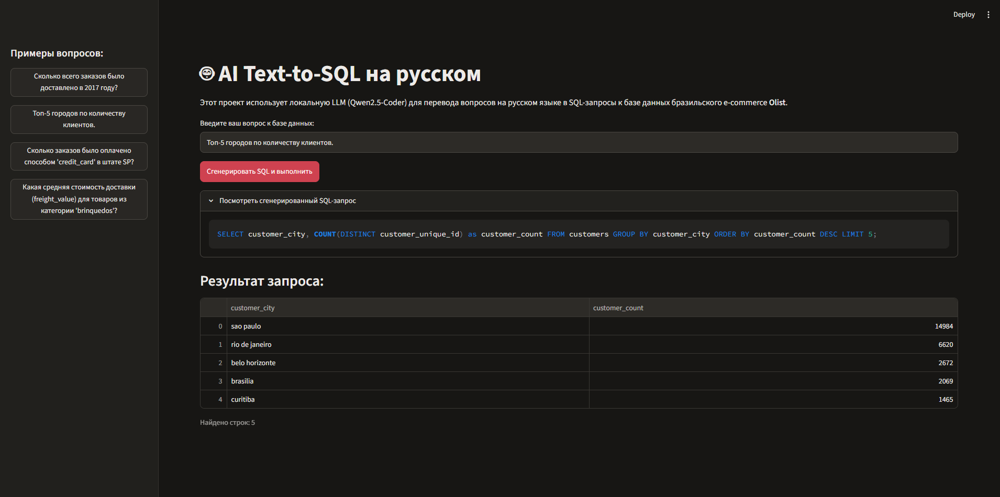

# 🤖 AI Text-to-SQL для E-commerce (Olist)

[](https://www.python.org/)
[](https://duckdb.org/)
[](https://streamlit.io/)
[](https://ollama.com/)

Пет-проект, демонстрирующий навыки построения End-to-End пайплайна Text-to-SQL на базе локальной LLM. Проект позволяет пользователям без знания SQL задавать вопросы к базе данных бразильского маркетплейса Olist на естественном русском языке.

 <!-- Убедитесь, что скриншот лежит по этому пути -->

## 🎯 Ключевые особенности
* **Полностью локально и бесплатно:** Никаких API-ключей и оплаты за токены. Используется модель Qwen2.5-Coder 7B через Ollama.
* **Безопасность:** Встроенный валидатор блокирует любые деструктивные запросы (`DELETE`, `DROP`, `UPDATE`). Разрешены только `SELECT` и `WITH`.
* **Современный стек:** DuckDB для быстрой аналитики (OLAP), Streamlit для UI.

## ⚙️ Архитектура
1. **Пользователь** вводит вопрос в интерфейс Streamlit.
2. **Промпт-билдер** добавляет схему БД (с русскими описаниями) и Few-shot примеры.
3. **Локальная LLM (Qwen2.5)** генерирует SQL-запрос.
4. **Валидатор** очищает ответ от markdown и проверяет на безопасность.
5. **DuckDB** выполняет запрос и возвращает Pandas DataFrame.

## 📊 Оценка качества (Evaluation & Error Analysis)
На тестовом наборе из 5 вопросов разной сложности (JOIN, агрегации, фильтры по датам) модель показала **Execution Accuracy: 100% (5/5)**.

В ходе разработки была проведена работа по улучшению точности:
1. *Первый прогон показал 80% из-за "галлюцинации" названия таблицы (`reviews` вместо `order_reviews`). Была дополнена схема в промпте и добавлены Few-shot примеры.*
2. *При тестировании на невиданных данных (zero-shot) модель допустила семантическую ошибку: на вопрос «Какой средний **вес** товаров доставлен в RJ?» она сгенерировала подсчет `freight_value` (стоимости доставки) вместо `product_weight_g` (веса товара), так как не связала поле с таблицей `products`.*
3. *Для исправления в базу Few-Shot примеров был добавлен паттерн с JOIN таблицы `products` для запросов про физические характеристики. После этого модель стабильно выдает правильный SQL.*

## 🚀 Как запустить локально

1. **Клонируйте репозиторий:**
   ```bash
   git clone https://github.com/a-bulychev/olist_text_to_sql.git
   cd olist_text_to_sql
   ```

2. **Настройте окружение:**
   ```bash
   python -m venv .venv
   # Windows: .venv\Scripts\activate
   # Mac/Linux: source .venv/bin/activate
   pip install -r requirements.txt
   ```

3. **Скачайте данные:**
Скачайте [Brazilian E-Commerce Public Dataset by Olist](https://www.kaggle.com/datasets/olistbr/brazilian-ecommerce) и положите 9 CSV-файлов в папку `data/`

4. **Загрузите данные в DuckDB:**
   ```bash
   python src/load_data.py
   ```

5. **Установите Ollama и модель:**

   Установите [Ollama](https://ollama.com/), затем выполните в терминале:
   ```bash
   ollama pull qwen2.5-coder:7b-instruct-q5_K_M

6. **Запустите приложение:**
   ```bash
   streamlit run app.py

## 🗂️ Структура проекта
```bash
├── app.py                 # Интерфейс Streamlit
├── examples/
│   └── few_shot_ru.json   # Примеры "вопрос -> SQL"
├── images/
│   └── demo_screenshot.png# Скриншот интерфейса
├── src/
│   ├── load_data.py       # ETL: загрузка CSV в DuckDB
│   ├── pipeline.py        # Ядро: промпт, вызов LLM, валидация
│   ├── evaluate.py        # Скрипт оценки точности
│   └── get_ground_truth.py# Получение эталонных ответов
├── schema_ru.md           # Русское описание схемы БД
├── requirements.txt
└── README.md
```
